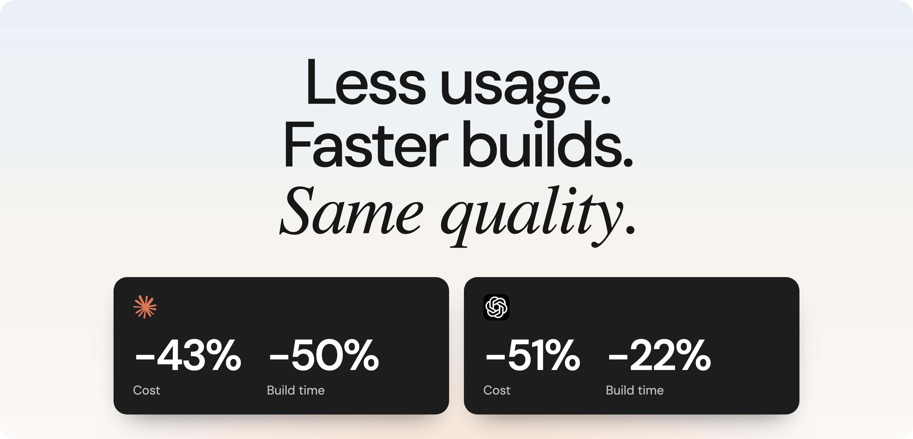
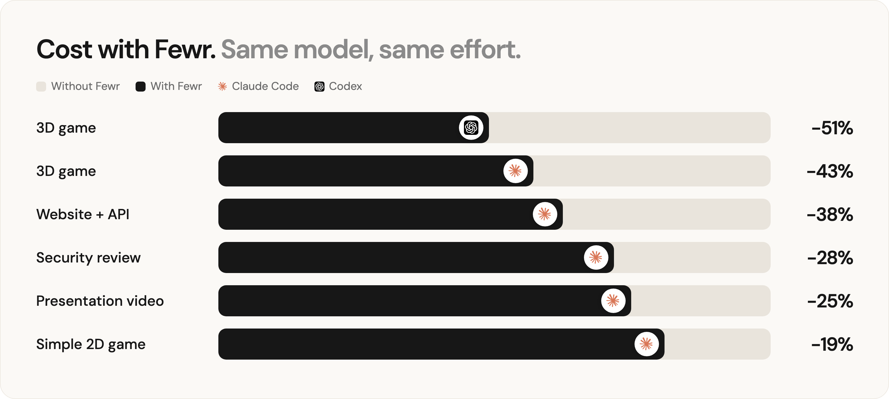
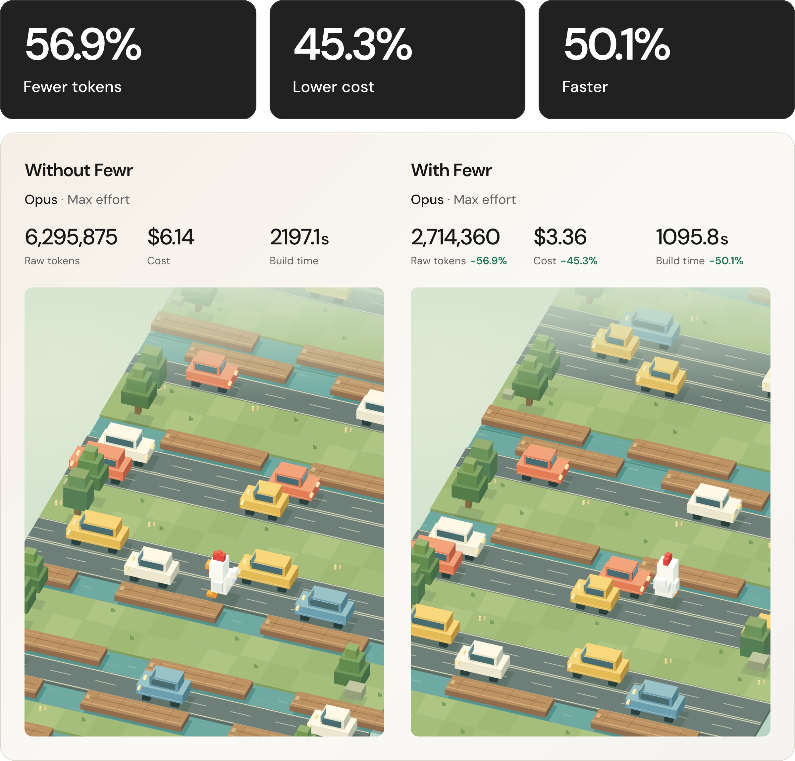
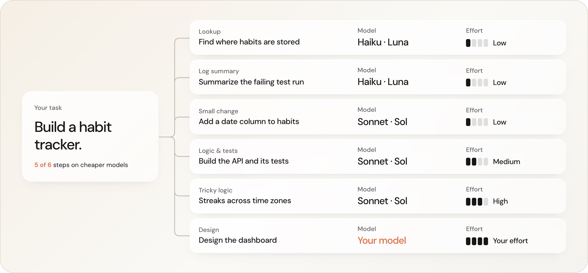

<p align="center">
  <picture>
    <source media="(prefers-color-scheme: dark)" srcset="assets/logo-dark.png">
    
  </picture>
</p>

<p align="center">
  <em>Less usage. Faster builds. Same quality.</em><br>
  <sub>Built by <a href="https://x.com/flojousselin">@flojousselin</a></sub>
</p>

<p align="center">
  <a href="https://x.com/flojousselin"></a>
  <a href="https://www.npmjs.com/package/fewr"></a>
  
  
</p>

<p align="center">
  
</p>

## Installation

### Prerequisites

- [Node.js](https://nodejs.org) 22 or later
- Claude Code or Codex, signed in

### Claude Code

1. Run this one command and you're set:
   ```sh
   npx fewr
   ```
2. Start a new chat. Fewr loads when a chat starts, so chats already open keep running without it.
3. Type `/fewrstats` in any chat to see your savings.

### Codex

1. Run the same command:
   ```sh
   npx fewr
   ```
2. In Codex, type `/hooks`. Find **Fewr: SessionStart** and **Fewr: record usage**, and trust both. Codex keeps new hooks off until you do.
3. Start a new chat.
4. Type `$fewrstats` in any chat to see your savings.

To remove Fewr: `npx fewr uninstall`.

## Benchmark

<p align="center">
  
</p>

Same task, same model, same effort, with and without Fewr. Each result is the average of two runs, and hidden checks graded every build.

## Before / after

<p align="center">
  
</p>

Same game, same model, same effort. Without Fewr: 6.3M tokens, $6.14, 37 minutes. With Fewr: 2.7M tokens, $3.36, 18 minutes. Both pass all 12 hidden checks and play the same. This is one of the two runs in the benchmark; across both, cost fell 43% on average.

## Why Fewr is different

Most ways to save usage give up some quality to get there:

| Approach | What it does | The catch |
|---|---|---|
| A cheaper model | Runs the whole session on Sonnet or a mini model | The hard parts (architecture, design, security) get the weaker model too |
| Lower effort | Thinks less on every turn | Less thinking on exactly the turns that need it |
| Trimming and compression | Shortens prompts, context or replies | Saved 0–11% in our tests, and rules about *how* to work made models think more, not less |
| Proxies and routers | Re-route your subscription's traffic | Breaks Anthropic's and OpenAI's terms and puts your account at risk |

Fewr doesn't turn anything down across the board. It splits the work:

<p align="center">
  
</p>

- **Your model keeps the decisions.** Architecture, design, security judgement and review stay on the model and effort you chose.
- **Each subtask gets the right model.** Lookups, tests and well-defined code go to the cheapest model and effort that does them well, and escalate if they fail.
- **Nothing in between.** Fewr runs through Claude Code's and Codex's own hooks, with your login, on your machine.
- **Measured, not promised.** Every benchmark compares the same model at the same effort, with hidden checks grading both builds. `/fewrstats` shows what it saves in your own chats.

## Follow along

<p align="center">
  <a href="https://x.com/flojousselin"></a>
</p>

## License

[AGPL-3.0](LICENSE). Free to use, modify and share. If you distribute a modified version, or offer one as a network service, you must publish its source under the same license. The Fewr name, logo and website content are not covered; see [NOTICE](NOTICE). © 2026 Florian Jousselin.
